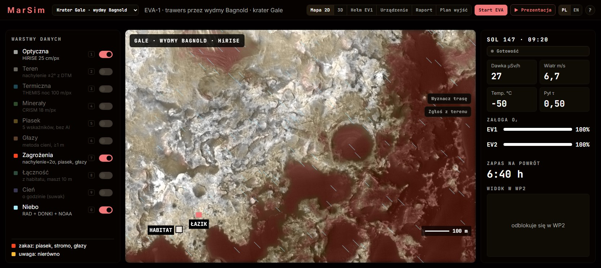

# MarSim

Mapa i planer wyjść (EVA) dla astronautów na Marsie. Robimy to na NASA Space Apps Challenge 2026 (Stalowa Wola).

Pomysł jest prosty: astronauta wychodzi z habitatu z ograniczonym zapasem tlenu i musi wiedzieć, którędy iść, żeby nie wejść na zbyt stromy stok albo w piasek, i kiedy zawrócić. MarSim pokazuje teren z prawdziwych danych NASA, wyznacza bezpieczną trasę, a w trakcie wyjścia pilnuje tlenu i zapasu na powrót.

Wersja online (bez serwera): https://aqayooooo.github.io/MarSim/



## Co umie

- Dwa obszary, każdy 1440 × 960 m: krater Gale (wydmy Bagnold, 4,67° S 137,38° E) i krater Jezero (lądowisko Perseverance, 18,44° N 77,45° E).
- Warstwy z danych NASA: HiRISE (model wysokości 1 m, zdjęcia 0,25 m), CTX, THEMIS, MOLA, CRISM, pogoda kosmiczna z DONKI i NOAA SWPC. Lista wszystkich plików z sumami SHA-256 jest w [data-sources.json](data-sources.json).
- Trasa liczona algorytmem A* po mapie kosztu tlenu. Limit nachylenia to 25° (z marginesem na niepewność modelu terenu), rezerwa tlenu 20%.
- Symulacja wyjścia na żywo: pozycja załogi, tlen, zapas na powrót, zgłoszenia przeszkód z terenu (trasa się przelicza), burza słoneczna.
- Prawdziwe trasy łazików: Curiosity w Gale (sole 956–1262) i Perseverance w Jezero (sole 13–382), z postojami i zdjęciami z Navcam.
- Widok 3D i widok z hełmu, po którym można chodzić, wejść do habitatu i pojechać łazikiem.
- PL i EN, działa na telefonie, po instalacji także bez internetu.

Warstwy liczymy zwykłymi, sprawdzalnymi metodami. Głazy wykrywamy z cieni na zdjęciach HiRISE (wysokość = długość cienia × tangens wysokości Słońca). Piasek oceniamy z pięciu wskaźników: ciemność, gładkość, zmarszczki wydm, chłód nocą na THEMIS i nierówności w modelu terenu. Minerały bierzemy z parametrów spektralnych CRISM.

## Jak uruchomić

Potrzebny jest Python 3.10+ i przeglądarka z WebGL.

Windows: kliknij `URUCHOM.bat`. Za pierwszym razem utworzy `.venv` i zainstaluje pakiety, potem otworzy http://localhost:8000.

Linux / macOS:

```
./uruchom.sh          # pełna wersja, http://localhost:8000
./uruchom.sh demo     # sam interfejs na danych przykładowych, http://localhost:5173
./uruchom.sh en       # po angielsku
./uruchom.sh install  # skrót w menu aplikacji
```

Na Windowsie działa to samo: `URUCHOM.bat demo`, `URUCHOM.bat en`. Inny port: `PORT=8001 ./uruchom.sh` (albo `set PORT=8001` na Windowsie).

Ręcznie:

```
python -m venv .venv
source .venv/bin/activate        # Windows: .venv\Scripts\activate
pip install -r requirements-runtime.txt
python backend/server.py
```

Docker:

```
docker build -t marsim .
docker run --rm -p 127.0.0.1:8000:8000 -v marsim-data:/data marsim
```

## Obsługa w skrócie

- Zakładki w nagłówku: Mapa 2D, 3D, Hełm EV1, Urządzenie, Raport, Plan wyjść. Obok wybór obszaru i PL/EN.
- **Start EVA** wyznacza trasę i wypuszcza załogę; ten sam przycisk pauzuje. **Wróć do habitatu** liczy drogę powrotną.
- **Zgłoś z terenu**: klik na mapie dodaje przeszkodę albo bezpieczne przejście.
- **Porównaj trasy** pokazuje, dlaczego wybrana trasa jest lepsza od prostej czy najkrótszej. **Co jeśli?** przelicza plan przy innym limicie nachylenia.
- **Punkty EVA**: własny plan wyjścia, do 8 punktów.
- W hełmie: klik łapie mysz, W A S D chodzenie, Shift bieg, spacja skok, 1–9 i 0 teleport do punktów, F wsiadanie do łazika, E obsługa stanowisk w habitacie.
- **Prezentacja**: automatyczny pokaz najważniejszych funkcji w 30 sekund.
- Pod **?** jest pełna lista skrótów.

## Struktura

```
index.html, styles.css   interfejs
src/                     moduły JS (bez kompilacji), three.js w vendor/
backend/                 serwer FastAPI, symulacja EVA, SQLite, potok danych NASA
data/missions/<id>/      gotowe warstwy dla Gale i Jezero
data/demo/               dane przykładowe dla trybu bez serwera
docs/                    plan, kontrakt danych, planer, bezpieczeństwo
tools/                   testy i skrypty pomocnicze
```

Przebudowa danych NASA (opcjonalna, ok. 0,5 GB surowych plików na obszar):

```
pip install -r requirements.txt
python backend/fetch_data.py --mission jezero
python backend/build.py --mission jezero
```

## Testy

```
python -m pytest backend/tests
node --test tools/test-eva.mjs
node --test tools/test-backdrop.mjs
node tools/test-planner.mjs
node tools/test-i18n.mjs
npm ci && npm run test:browser
```

CI na GitHubie odpala to samo, plus budowę obrazu Docker.

## Czego jeszcze nie ma

- Model zużycia tlenu (równanie Pandolfa przeliczone na grawitację Marsa) nie jest skalibrowany na prawdziwym skafandrze.
- Z orbity widać głazy od ok. 1 m. Mniejszych nie, od tego jest zgłaszanie przeszkód z terenu.
- Widok w punkcie WP2 to render z modelu terenu, nie zdjęcie.
- Nie ma logowania ani ról, serwer domyślnie słucha tylko lokalnie.
- Wersja na GitHub Pages nie ma serwera: raport, plan wyjść i pogoda kosmiczna są tam zapisanymi przykładami.

Więcej szczegółów: [CHANGELOG.md](CHANGELOG.md), [docs/PLANER.md](docs/PLANER.md), [docs/KONTRAKT_DANYCH.md](docs/KONTRAKT_DANYCH.md), [docs/BEZPIECZENSTWO.md](docs/BEZPIECZENSTWO.md).

## English

MarSim is a map and EVA planner for astronauts on Mars, made for NASA Space Apps Challenge 2026. It uses real NASA data (HiRISE, CTX, THEMIS, MOLA, CRISM, DONKI) for two areas, Gale crater and Jezero crater. It plans a safe walking route, tracks oxygen and the walk-back margin during the EVA, and lets you walk the route in 3D from a helmet view. Run `URUCHOM.bat en` on Windows or `./uruchom.sh en` on Linux/macOS.

## Licencja

Kod na licencji MIT ([LICENSE](LICENSE)). three.js: MIT. Czcionki Inter i JetBrains Mono: SIL OFL 1.1.

Dane: NASA/JPL-Caltech/University of Arizona (HiRISE), NASA/JPL/MSSS (CTX), NASA/JPL/ASU (THEMIS), NASA/GSFC (MOLA), NASA/JPL/JHUAPL (CRISM), USGS Astrogeology, NASA CCMC (DONKI), NOAA SWPC. Projekt nie jest popierany przez NASA.
