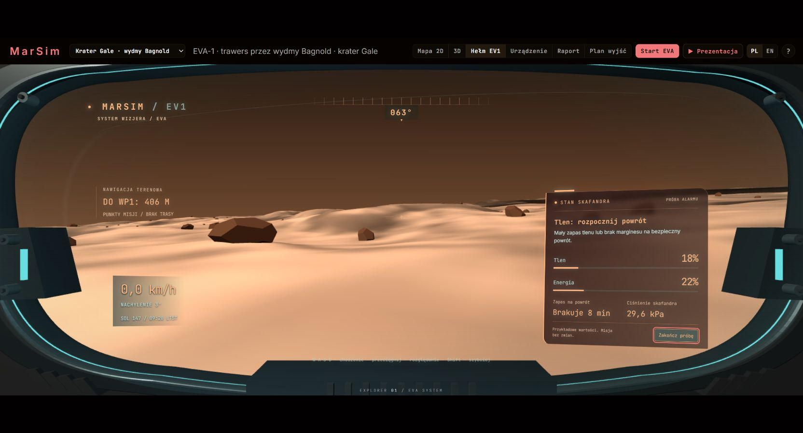

# MarSim — mapa i planer wyjść (EVA) dla astronautów na Marsie

Projekt na **NASA Space Apps Challenge 2026** (wydarzenie lokalne: Stalowa Wola), wyzwanie o mapie dla astronautów na Marsie.
*English summary below.*

MarSim pokazuje teren z prawdziwych danych NASA i wyznacza bezpieczną trasę pieszą. W czasie wyjścia śledzi załogę: pozycję, tlen i zapas na powrót do habitatu. Reaguje na zagrożenia (głazy, burza słoneczna), a trasę można przejść w 3D z perspektywy hełmu.

- **Dwa obszary misji** (przełącznik w nagłówku), każdy to wycinek 1440 × 960 m:
  - krater Gale, wydmy Bagnold u podnóża Mount Sharp (4,67° S, 137,38° E);
  - krater Jezero, okolica lądowiska łazika Perseverance (18,44° N, 77,45° E).
- **Dane:** HiRISE (DTM 1 m i zdjęcia 0,25 m), CTX, THEMIS, MOLA, CRISM, NASA DONKI, NOAA SWPC. Pełna lista z adresami i sumami SHA-256 jest w [data-sources.json](data-sources.json).
- **Bez uczenia maszynowego w produkcie.** Głazy wykrywa geometria cieni, piasek pięć wskaźników fizycznych, minerały parametry spektralne CRISM, a trasę algorytm A* z modelem wysiłku.

## Wynik prac · 10 listopada 2026

Wersja 1.4 zapisuje przebieg EVA i odtwarza go po restarcie w stanie pauzy. Dziennik ma kontrolę integralności i eksport CSV. Interfejs obsługuje powrót do habitatu, profil wysokości trasy, pomoc klawiaturową i sygnalizację utraty połączenia. Poprawiono obsługę błędów sterowania, przeliczanie trasy podczas pauzy i synchronizację sesji między kartami.

Poprawki po przeglądzie (wieczór 10 listopada): wyjście i postoje w punktach trasy kończą się dopiero, gdy dojdzie cała załoga, a nie tylko prowadzący. Raport i wizjer pokazują bieżący niedobór tlenu osoby w najgorszym stanie. Wersja bez serwera ma te same alarmy tlenu co backend i liczy zapas na powrót do habitatu. Pierwsze wyjście z harmonogramu na bieżący sol ustala godzinę startu i skład załogi symulowanej EVA. API odrzuca nowe wyznaczenie trasy w trakcie wyjścia oraz telemetrię tlenu ponad pojemność butli. Szczegóły w [CHANGELOG.md](CHANGELOG.md).

Weryfikacja: 281 testów backendu, 25 testów sterowania EVA (w tym pełne przebiegi demo, Mount Sharp i Jezero), trzy testy planera, 352 klucze tłumaczeń PL/EN oraz kontrola kodu Ruff. Test działającego serwera sprawdził strumień stanu, 360 równoległych zapytań i powrót do habitatu. Kontrola CI obejmuje też gałąź `pages-demo`.

Niezależne próby w przeglądarce objęły oba obszary NASA, PL/EN, wersję z backendem i bez niego, widoki 3D, jazdę łazikiem, formularze oraz pełne prezentacje. Naprawiono błędny komunikat marszu podczas pauzy, stary cel na urządzeniu po resecie i utratę zmian wprowadzonych podczas pauzy po restarcie serwera. [Zakres i wynik prób](docs/WERYFIKACJA-UI.md). Docker pozostaje niesprawdzony; nie jest zainstalowany na tym komputerze.


## Demo hełmu 3D

[Otwórz widok astronauty](https://aqayooooo.github.io/MarSim/?view=helmet&lang=pl) albo wybierz **Hełm EV1** w aplikacji. Wnętrze hełmu jest modelem 3D przy kamerze: metalowa rama, uszczelka, mocowania, śruby i dolna osłona. Widok terenu zajmuje szerokość ekranu, a dane wyglądają jak projekcja na szybie wizjera.

Panel w prawym dolnym rogu podsumowuje tlen, energię, ciśnienie i zapas na powrót osoby w najgorszym stanie i podaje jej identyfikator. Alarm „rozpocznij powrót” włącza się poniżej rezerwy tlenu misji. Wskazuje najpilniejsze zagrożenie oraz działanie. **Pokaż niedobór** uruchamia oznaczony przykład alarmu z małą ilością tlenu i energii; nie zmienia stanu misji. Bez backendu brakujące pomiary baterii i ciśnienia mają znak „—”.

Sterowanie: przeciągnij myszą, aby się rozejrzeć; W A S D lub strzałki pozwalają poruszać kamerą. To podgląd z perspektywy astronauty, niezależny od ruchu modelowanej EVA. Parametr `?view=helmet` otwiera ten widok od razu. Zdjęcia punktów trasy nadal przedstawiają sam teren, bez wnętrza hełmu.

Sprawdzono w przeglądarce: PL/EN, oba obszary NASA, z backendem i bez, rozglądanie, próbę alarmu i przełączanie mapy, 3D oraz hełmu. Przeszły testy sterowania i komunikatów wizjera oraz tłumaczeń.



## Uruchomienie

Wymagania: Windows, macOS albo Linux, **Python 3.10+** i przeglądarka z WebGL. Po pierwszej instalacji pakietów **działa bez internetu**: three.js i czcionki są w `vendor/`, a pogoda kosmiczna ma pamięć podręczną.

### Windows: jedno kliknięcie

| Polecenie | Co robi |
|---|---|
| `URUCHOM.bat` | pełna wersja z backendem: http://localhost:8000 (przy pierwszym uruchomieniu tworzy `.venv` i instaluje pakiety) |
| `URUCHOM.bat en` | to samo po angielsku |
| `URUCHOM.bat demo` | sam interfejs na danych przykładowych, bez instalacji: http://localhost:5173 |

### Ręcznie (każdy system)

```
python -m venv .venv
# Windows: .venv\Scripts\activate     macOS/Linux: source .venv/bin/activate
pip install -r requirements-runtime.txt
python backend/server.py              # http://localhost:8000
```

### Docker

```
docker build -t marsim .
docker run --rm -p 127.0.0.1:8000:8000 -v marsim-data:/data marsim
```

### Przebudowa danych NASA (opcjonalnie)

Do przebudowy zainstaluj dodatkowe biblioteki poleceniem `pip install -r requirements.txt`.

Gotowe pliki misji są w `data/missions/<misja>/` (`mount-sharp`, `jezero`). Surowe produkty (ok. 0,5 GB na misję) trafiają poza repozytorium. Katalog wskazuje zmienna `MARSIM_DATA` albo plik `backend/config/paths.local.json`, np. `{ "dataDir": "D:/MarSim-data" }`.

```
python backend/fetch_data.py --mission jezero    # pobiera brakujące produkty, liczy SHA-256
python backend/build.py --mission jezero         # pełny potok → data/missions/jezero
python backend/build.py --mission jezero --only-minerals   # tylko warstwa CRISM
python tools/make_data_sources.py                # odświeża data-sources.json
```

## Obsługa

- **Obszar misji**: lista w nagłówku (Gale / Jezero). Każdy obszar ma osobną bazę (dziennik, zgłoszenia, harmonogram).
- **PL / EN**: przełącznik w nagłówku (albo `?lang=en` w adresie).
- **Warstwy**: kliknięcie albo spacja na wierszu w lewym panelu.
- **Mapa 2D / 3D / Hełm EV1 / Urządzenie / Raport / Plan wyjść**: zakładki w nagłówku.
- **Hełm**: klawisze W A S D lub strzałki to chodzenie, mysz to rozglądanie, Shift przyspiesza. Kolizje z terenem powyżej 25° i z głazami.
- **⇄ Porównaj trasy** (na mapie; bez serwera — dla pierwszej trasy z zapisanych danych backendu): dlaczego wybrano tę trasę. Planer porównuje ją z linią prostą, najkrótszą bezpieczną i wariantem bez stref „uwaga” i podaje liczbowe powody (metry w strefach zakazanych, nachylenie, tlen, czas).
- **Start EVA**: wyznacza trasę i rusza z załogą. Ten sam przycisk wstrzymuje i wznawia marsz. **Powrót do habitatu** wyznacza trasę powrotną; po dotarciu pojawia się **Nowe wyjście**.
- **Profil trasy**: wykres wysokości, strefy „uwaga” i bieżąca pozycja załogi. Wskazanie wykresu pokazuje odpowiadające miejsce na mapie.
- **?**: pomoc i skróty. M/O/H/U/R/G zmieniają widok, 1–9 i 0 przełączają warstwy, spacja steruje EVA, B wyznacza powrót, P otwiera profil, C porównuje trasy.
- **Plan wyjść**: harmonogram z kontrolą zapasów, odpoczynku i światła dziennego. Wpis można dodać, edytować i usunąć. Pierwsze wyjście na bieżący sol ustala godzinę startu i załogę EVA; zmiana działa po resecie wyjścia.
- **Prezentacja** odtwarza scenariusz w 8 krokach. Zatrzymanie wstrzymuje EVA. Po końcu zostaje mapa z przebytą trasą.
- **＋ Zgłoś z terenu**: kliknięcie na mapie dodaje przeszkodę albo bezpieczne przejście. Trasa przelicza się, jeśli trzeba.

## Co jest w środku

```
index.html, styles.css     ekran 1664×744 skalowany do okna
src/                       interfejs (moduły ES, bez kompilacji)
  i18n.js                  tłumaczenia PL/EN
  data/source.js           jedyne miejsce styku z danymi (pliki albo backend)
  ui/                      mapa 2D, 3D i hełm, panele, raport, harmonogram
vendor/                    three.js 0.160.0 i czcionki (offline)
backend/
  server.py                API (FastAPI) + walidacja pydantic, wiele misji (/api/missions)
  config/missions/<id>.json  konfiguracja obszaru: wycinek, habitat, trasa, załoga, produkty NASA
  sources/<id>.json        produkty NASA do pobrania dla obszaru
  live/                    silnik EVA, SQLite (store.py), raport, harmonogram, DTN, pogoda kosmiczna
  pipeline/                teren, głazy, piasek, minerały (CRISM), środowisko
  build.py, fetch_data.py  potok danych NASA
data/missions/<id>/        gotowe warstwy misji + provenance.json (pochodzenie i sumy kontrolne)
  backend/                 przykładowe odpowiedzi backendu dla wersji bez serwera (tools/export_backend_sample.py)
data/missions/index.json   lista misji dla wersji bez serwera (wybór obszaru, domyślna misja)
data/demo/                 dane syntetyczne (tryb bez backendu)
data-sources.json          wykaz użytych danych
docs/                      plan, kontrakt danych, bezpieczeństwo
```

**Zapis stanu.** Baza SQLite `marsim-<misja>.db` przechowuje dziennik, zgłoszenia, harmonogram oraz punkt kontrolny trwającej EVA. Serwer zapisuje go co 5 sekund, przy pauzie oraz po zmianach wprowadzonych podczas pauzy. Po restarcie odtwarza trasę, zasoby i pozycję załogi w stanie pauzy. Wiadomości DTN w drodze i chwilowe odczyty czujników nie wchodzą do punktu kontrolnego. Nowe wyjście usuwa ten punkt i tworzy nową sesję.

**Uruchamianie serwera.** `python backend/server.py --help` pokazuje port, adres nasłuchu, misję startową i katalog baz. `--no-live-feeds` wyłącza pobieranie pogody kosmicznej; `--version` podaje wersję. Opis API jest pod `/api/docs`. Raport pokazuje założenia obliczeń i wynik kontroli dziennika; eksport CSV jest pod `/api/log/export`.

**Testy.**
Po instalacji `requirements.txt`:

- `python -m pytest backend/tests` — API, modele, planer, zapis i wznowienie EVA;
- `node --test tools/test-eva.mjs` — sterowanie, błędy połączenia i pełne lokalne przebiegi;
- `node tools/test-planner.mjs` oraz to samo z argumentami `data/missions/mount-sharp` i `data/missions/jezero`;
- `node tools/test-i18n.mjs` — tłumaczenia;
- `python -m ruff check backend tools` i `python -m ruff format --check backend tools`;
- `python tools/smoke_http.py` — test osobnego serwera HTTP na porcie 8765, z tymczasową bazą.

Uruchamia je też CI (`.github/workflows/ci.yml`).

**Klucz NASA API.** DONKI działa na wspólnym kluczu `DEMO_KEY` o niskich limitach. Własny, darmowy klucz z https://api.nasa.gov ustaw w zmiennej `NASA_API_KEY`.

## Ograniczenia

- Widok w punkcie WP2 to **render z modelu terenu HiRISE**, nie zdjęcie z kamery łazika. Interfejs to podpisuje.
- Model tlenu (równanie Pandolfa przeliczone na 0,38 g) nie jest skalibrowany danymi z prawdziwego skafandra.
- Wykrywanie głazów widzi obiekty od ok. 1 m. Mniejsze kamienie nie są widoczne z orbity.
- Brak logowania i ról. Serwer domyślnie słucha tylko lokalnie. Szczegóły: [docs/BEZPIECZENSTWO.md](docs/BEZPIECZENSTWO.md).
- Układ ekranu jest stały (skalowany), nie przebudowuje się na telefon. Dostępność poprawiona, ale bez pełnego audytu WCAG.
- Wersja pod linkiem (GitHub Pages: https://aqayooooo.github.io/MarSim/) działa bez serwera. Raport, plan wyjść, pogoda kosmiczna, dziennik i pierwsza trasa (z wariantami „dlaczego ta trasa”) pochodzą z zapisanych odpowiedzi prawdziwego backendu i są tylko do odczytu; symulacja EVA i nowe trasy liczą się w przeglądarce (planer zastępczy A*). Odświeżenie zapisu: `.venv/Scripts/python.exe tools/export_backend_sample.py`.
- Mapa piasku i zagrożeń jest względna dla wycinka (wskaźniki porównują miejsca w obrębie obszaru), więc procent „piasku” w różnych obszarach nie jest bezpośrednio porównywalny.

## Dokumenty

- [CHANGELOG.md](CHANGELOG.md): historia zmian;
- [docs/PLAN.md](docs/PLAN.md): etapy i stan prac;
- [docs/KONTRAKT_DANYCH.md](docs/KONTRAKT_DANYCH.md): format danych między backendem a UI;
- [docs/BEZPIECZENSTWO.md](docs/BEZPIECZENSTWO.md): bezpieczeństwo i droga do wdrożenia;
- [docs/ROADMAPA.md](docs/ROADMAPA.md): wykonane ulepszenia i dalsze prace;
- [docs/PLANER.md](docs/PLANER.md): wejścia, wyniki i ograniczenia planera.

## Licencja i podziękowania

Kod: licencja MIT ([LICENSE](LICENSE)). three.js: MIT. Czcionki Inter i JetBrains Mono: SIL OFL 1.1.

Dane: NASA/JPL-Caltech/University of Arizona (HiRISE), NASA/JPL/MSSS (CTX), NASA/JPL/ASU (THEMIS), NASA/GSFC (MOLA), NASA/JPL/JHUAPL (CRISM), USGS Astrogeology (mozaiki), NASA CCMC (DONKI), NOAA SWPC. Projekt nie jest popierany przez NASA.

---

## English summary

**MarSim** is a map and EVA planner for astronauts on Mars, built for NASA Space Apps Challenge 2026. It uses real NASA data for two areas, the Bagnold dunes in Gale crater and the Perseverance landing site in Jezero crater:
- HiRISE DTM and orthoimages, CTX, THEMIS, MOLA and CRISM;
- live DONKI and NOAA space weather.

It shows hazard layers with uncertainty and plans a safe walking route. During the EVA it tracks crew oxygen and the walk-back limit, and replans around field reports. The route can also be viewed in 3D or from a helmet camera.

- **Run (Windows):** double-click `URUCHOM.bat`, or `URUCHOM.bat en` for English.
- **Run (any OS):** `pip install -r requirements-runtime.txt`, then `python backend/server.py`, then open http://localhost:8000.

It works offline after the first install. All data products are listed in [data-sources.json](data-sources.json).
