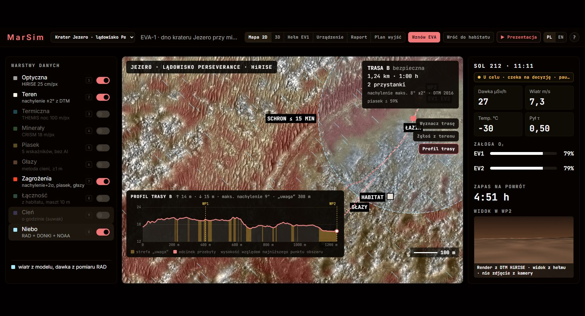

# Próby interfejsu · 10 listopada 2026

Próby wykonano w przeglądarce, klikając elementy interfejsu i sprawdzając widoczny wynik. Użyto oddzielnej bazy testowej. Próby uzupełniają testy automatyczne.

| Zakres | Wynik |
|---|---|
| Mapa i wybór obszaru | Gale i Jezero w wersji z backendem i bez niego; syntetyczne demo także wczytuje teren i 3D. |
| PL/EN | Zmiana języka zachowuje aktywną EVA backendu; etykiety, raport i pomoc zmieniają język. |
| Warstwy | Wszystkie 10 przełączników włącza i wyłącza warstwy; nie pojawiły się błędy w konsoli. |
| EVA | Start, pauza, wznowienie, powrót do habitatu, koniec wyjścia i nowa sesja działają z przycisków. |
| Odświeżenie strony | Wstrzymana EVA zachowuje czas i stan; nie tworzy nowej sesji. |
| Utrata połączenia | Pojawia się pasek utraty łączności. Po uruchomieniu serwera połączenie wraca. |
| Restart podczas pauzy | Po poprawce zapis zachowuje także trasę powrotną wyznaczoną podczas pauzy. Sprawdzono ponownym restartem i odczytem stanu w interfejsie. |
| Profil i porównanie tras | Wykres, punkty trasy, pozycja załogi i warianty tras są widoczne; panele nie nakładają się na siebie. |
| 3D, hełm i urządzenie | Teren się renderuje, widoki przełączają się, urządzenie pokazuje właściwy cel i stan ruchu. |
| Trasa A→B i łazik | Wybór startu i celu na mapie, przejazd 3D, pauza, kamera w kabinie oraz zakończenie jazdy działają. |
| Zgłoszenie z terenu | Formularz przyjmuje przeszkodę i przelicza lokalną trasę także podczas pauzy. |
| Harmonogram | Wpis testowy zapisano i usunięto z poziomu formularza. |
| Raport | Widoczne są założenia i wynik kontroli dziennika. Wersja statyczna oznacza przykładowe dane jako tylko do odczytu. |
| Prezentacja | Pełne 8 kroków na Jezero w wersji backendowej EN i statycznej PL. Po końcu zostaje mapa, EVA jest wstrzymana, sterowanie działa. |
| Pomoc i układ | Skróty `?` i `Esc` otwierają i zamykają pomoc. Układ mieści się w oknie 1024×768; przy większym oknie zachowuje proporcje. |

## Poprawki po próbach

- Urządzenie pokazywało „marsz” podczas pauzy w fazie marszu lub powrotu. Teraz uwzględnia stan zatrzymania.
- Nowe wyjście mogło zostawić poprzedni cel na urządzeniu. Reset czyści cel i odległość.
- Restart gubił trasę powrotną i inne zmiany wykonane po ostatniej pauzie. Serwer zapisuje teraz zmiany wprowadzane podczas pauzy od razu.
- Tytuł przycisku EVA odpowiada jego bieżącej funkcji. Formularz harmonogramu nazywa operację dodawaniem, zgodnie z działaniem.
- Wyłączone źródła pogody pokazują brak danych zamiast stałego komunikatu pobierania.

Po poprawkach przeszło 271 testów backendu i 20 testów sterowania, w tym nowe regresje powyższych błędów. Test tłumaczeń i Ruff również przeszły. W obserwowanych przebiegach przeglądarka nie zgłosiła błędów JavaScript ani WebGL.

Nie wykonano testu każdej kombinacji ustawień, audytu dostępności ani kontroli Dockera. Układ nadal skaluje stały ekran; nie ma osobnego układu telefonu.

